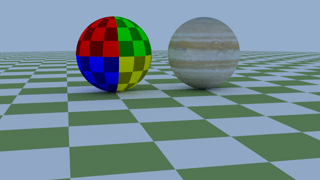
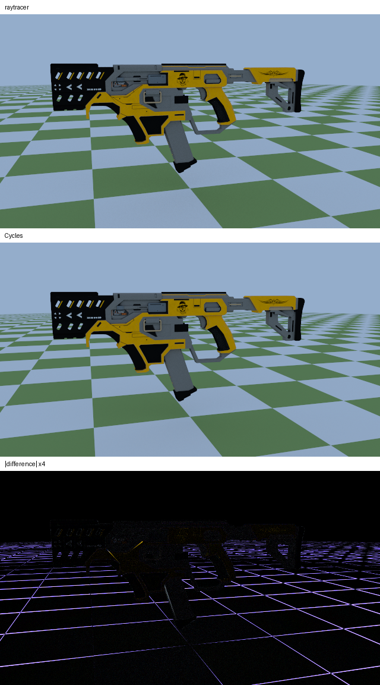

# Raytracer

A physically based CPU path tracer in C++, with scenes described in Lua.




<sub>Jupiter map: "Merged Cassini and Juno global map of Jupiter", processed by
Björn Jónsson. NASA / JPL-Caltech / SSI / Southwest Research Institute / Malin
Space Science Systems / Italian Space Agency (ASI) / Italian National Institute
for Astrophysics (INAF) / JIRAM / Björn Jónsson,
[CC BY 3.0](https://creativecommons.org/licenses/by/3.0/)
([source](https://www.planetary.org/space-images/merged-cassini-and-juno)).
Wrapped onto a sphere and rendered.</sub>

## Strong similarity with Cycles

### **Matches Blender's Cycles.**
A textured OBJ rendered in my raytracer and then in Cycles, 256 samples: mean absolute difference 2.4/255, which I can chalk up to noise.




<sub>Left: this renderer. Middle: Cycles. Right: the difference. Model:
"SMG GUN Remastered" by
[ROHIT3DMODELS](https://sketchfab.com/3d-models/smg-gun-remastered-2e9bf758703847c88d854fa204384203),
[CC-BY-4.0](http://creativecommons.org/licenses/by/4.0/)
([source](https://sketchfab.com/3d-models/smg-gun-remastered-2e9bf758703847c88d854fa204384203)).</sub>

## Write-ups

- [Apparently, Bland 2D Grey Squares Are Important to My 3D Renderer](https://dev.to/ibukunsanni/apparently-bland-2d-grey-squares-are-important-to-my-3d-renderer-21fo):
  the white furnace test, and what failing it looks like.
- [A Hexagonal Aperture Would Break Every Diffuse Surface in My Renderer](https://dev.to/ibukunsanni/a-hexagonal-aperture-would-break-every-diffuse-surface-in-my-renderer-3874):
  Malley's method, and a bug the furnace can't see.
- [My Renderer and Blender Painted the Same Gun](https://dev.to/ibukunsanni/my-renderer-and-blender-painted-the-same-gun-32af):
  textures from *Ray Tracing: The Next Week*, then a textured model checked
  against Blender's Cycles.

## Features

- Path tracing with Russian roulette, and energy-conserving BSDFs
  (Lambertian, Blinn-Phong, mirror, metal, dielectric)
- Textures: spatial and UV checkers, sRGB image textures, sphere UVs, and OBJ
  `vt` interpolated by barycentric weights
- Spheres, boxes and OBJ meshes in a scene graph; a per-mesh BVH (median or
  SAH split, recursive or iterative traversal)
- Image-based lighting, point-light shadow rays, thin-lens depth of field
  with shaped apertures
- Debug views of normals, albedo and (u, v)
- multithreaded rendering across 20 cores on the CPU

## Build and run

C++17 and CMake 3.16+. Every dependency is vendored under `third_party/`.
On Windows with MSYS2, add `-G "MinGW Makefiles"` to the first command.

```bash
cmake -S . -B build -DCMAKE_BUILD_TYPE=Release && cmake --build build -j
./build/raytracer assets/scenes/macho-cows.lua    # run from the repo root
ctest --test-dir build -j 8 --output-on-failure   # tests, in parallel
```

Output file, resolution and camera come from the scene's `gr.render` call.
To write a scene, copy [`assets/scenes/template.lua`](assets/scenes/template.lua).
Image textures are not in git; a scene whose texture is missing renders a
grey-and-white placeholder checker instead.


## Provenance and licensing

Began as assignment 4 of Waterloo's CS488; some scaffolding (`polyroots.cc`, the
Lua bindings, `Image`) is course-provided. Everything listed under "Measured"
above was built here, after the course. Vendored code keeps its licence: glm
(MIT), lodepng (zlib), Lua (MIT). Third-party models and textures keep theirs;
each has a `*_license.txt` beside it. No licence is chosen yet for the
original work.
