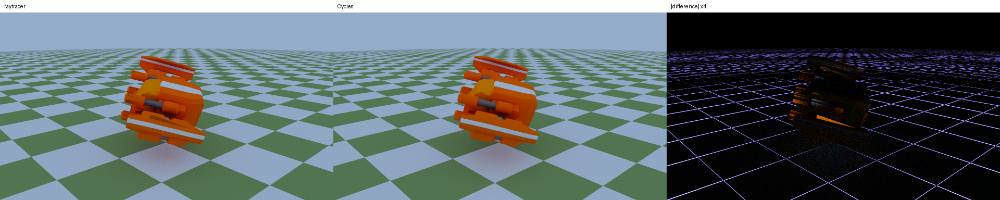

# Raytracer

A physically based CPU path tracer in C++, with scenes described in Lua.
Every feature lands with a measurement: a test it must pass, a reference it
must match, or a number it must move.


<sub>Jupiter map: "Merged Cassini and Juno global map of Jupiter", processed by
Björn Jónsson. NASA / JPL-Caltech / SSI / Southwest Research Institute / Malin
Space Science Systems / Italian Space Agency (ASI) / Italian National Institute
for Astrophysics (INAF) / JIRAM / Björn Jónsson,
[CC BY 3.0](https://creativecommons.org/licenses/by/3.0/)
([source](https://www.planetary.org/space-images/merged-cassini-and-juno)).
Wrapped onto a sphere and rendered.</sub>

## Measured, not eyeballed

- **Matches Blender's Cycles.** A textured OBJ rendered here and in Cycles,
  same scene, 256 samples: mean colour within **0.2/255**, mean absolute
  difference 2.9/255, and that is sampling noise, not misplaced texels.
- **Conserves energy.** A white sphere in a uniform environment vanishes: to
  within one byte for diffuse and mirror, and on average for glass. Deliberately breaking a
  material moves the sphere by the amount the math predicts (128 → 85 for a
  doubled cosine).
- **BVH: 304× faster** than a linear scan on the hardest scene (21,084 → 8.5
  triangle tests per ray), with a profiler breakdown of where the remaining
  time goes, and why recursive and iterative traversal cost the same.
- **Sampler tests that can fail.** BSDF sampling is checked by moments that
  don't cancel, because the obvious check cannot fail. Each check was
  verified by breaking the code on purpose first.



<sub>Left: this renderer. Middle: Cycles. Right: the difference, ×4. Model:
"Cartoon spaceship" by
[pinguinoconpulgares](https://sketchfab.com/pinguinoconpulgares),
[CC-BY-4.0](http://creativecommons.org/licenses/by/4.0/)
([source](https://sketchfab.com/3d-models/cartoon-spaceship-a377d653202f45a68d441a987aa6dbda)).</sub>

## Write-ups

- [Apparently, Bland 2D Grey Squares Are Important to My 3D Renderer](https://dev.to/ibukunsanni/apparently-bland-2d-grey-squares-are-important-to-my-3d-renderer-21fo):
  the white furnace test, and what failing it looks like.
- [A Hexagonal Aperture Would Break Every Diffuse Surface in My Renderer](https://dev.to/ibukunsanni/a-hexagonal-aperture-would-break-every-diffuse-surface-in-my-renderer-3874):
  Malley's method, and a bug the furnace can't see.

## Features

- Path tracing with Russian roulette, and energy-conserving BSDFs
  (Lambertian, Blinn-Phong, mirror, metal, dielectric)
- Textures: spatial and UV checkers, sRGB image textures, sphere UVs, and OBJ
  `vt` interpolated by barycentric weights
- Spheres, boxes and OBJ meshes in a scene graph; a per-mesh BVH (median or
  SAH split, recursive or iterative traversal)
- Image-based lighting, point-light shadow rays, thin-lens depth of field
  with shaped apertures
- Linear-colour accumulation, tone-mapped once at write-out
- Debug views of normals, albedo and (u, v); multithreaded rendering

## Build and run

C++17 and CMake 3.16+. Every dependency is vendored under `third_party/`.
On Windows with MSYS2, add `-G "MinGW Makefiles"` to the first command.

```bash
cmake -S . -B build -DCMAKE_BUILD_TYPE=Release && cmake --build build -j
./build/raytracer assets/scenes/macho-cows.lua    # run from the repo root
ctest --test-dir build -j 8 --output-on-failure   # tests, in parallel
```

Output file, resolution and camera come from the scene's `gr.render` call.
To write a scene, copy [`assets/scenes/template.lua`](assets/scenes/template.lua).
Image textures are not in git; a scene whose texture is missing renders a
grey-and-white placeholder checker instead.

| Environment variable | Effect |
|---|---|
| `RT_LOG=debug`, `RT_LOG=off,geom:debug` | Log verbosity, overall or per category |
| `BVH_TRAVERSAL=linear\|recursive\|iterative` | Which intersection path meshes use (default `iterative`) |
| `BVH_SPLIT=median\|sah` | How the BVH is split when a mesh loads (default `median`) |
| `BVH_VERIFY=1` | Check the BVH against the linear scan on every ray |
| `RT_STATS=1` | Count nodes visited and triangles tested (off by default: counting slows the render ~17-20%) |
| `RT_THREADS=n`, `RT_SPP=n` | Thread count (default: all hardware threads) and samples per pixel (default: the scene's). The image depends on both |
| `RT_VIEW=normal\|albedo\|uv` | Write the primary hit's normal, unshaded surface colour, or (u, v) as red and green, instead of shading, with no tone map and no sRGB |

## Docs

- [WALKTHROUGH](docs/WALKTHROUGH.md): one ray, from `main()` to a byte in a PNG
- [ROADMAP](docs/ROADMAP.md): status, the plan, and the measurements
- [ENGINEERING](docs/ENGINEERING.md): scope, decisions and the write-up plan
- [REFERENCE](docs/REFERENCE.md): logging, scene format, tests, style, performance

## Provenance and licensing

Began as assignment 4 of Waterloo's CS488; some scaffolding (`polyroots.cc`, the
Lua bindings, `Image`) is course-provided. Everything listed under "Measured"
above was built here, after the course. Vendored code keeps its licence: glm
(MIT), lodepng (zlib), Lua (MIT). Third-party models and textures keep theirs;
each has a `*_license.txt` beside it. No licence is chosen yet for the
original work.
