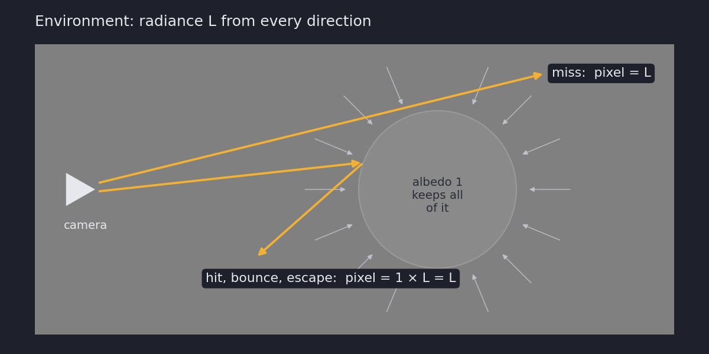
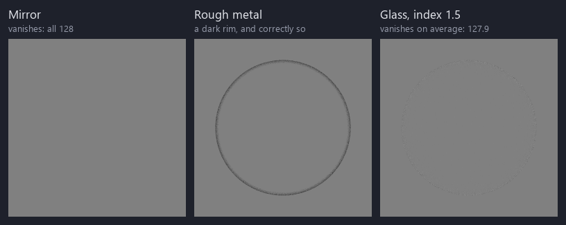

{fig-alt="A flat grey square." width=256}

There’s a sphere in that picture. Can you see it? No, you can’t. If you could, my renderer would be wrong, and I wouldn’t like that.

## What is the furnace test?

Put a sphere of albedo 1 (a surface that absorbs nothing) inside an
environment of radiance $L$ in every direction. Every camera ray either
misses the sphere or hits it.

- $P$: **a miss reads $L$.** It escapes straight to the environment. True by
  construction: I built the scene that way.
- $Q$: **a hit bounces until it misses, so it reads $L$ too.** It keeps
  everything on the way, $1 \times L = L$. This is the one on trial: it's true
  only if the renderer conserves energy.
- $R$: **the square is flat grey.** Every pixel reads $L$, so the sphere has
  no edge.

$$
P \wedge Q \Rightarrow R
$$

{fig-alt="A diagram: a camera on the left, a grey sphere on the right with light arriving from all around it, and two orange rays, one missing the sphere and one bouncing off it."}

The test runs it backwards. If I can see the sphere, $R$ is false, so $P$ or
$Q$ is. $P$ can't be, so $Q$ is: the renderer is losing energy if the sphere
is darker, and making it if the sphere is brighter. If the furnace test is working, you see nothing. Naruto would be proud.

To see a real-world example of this, I highly recommend Julien Guertault's
["The white furnace test"](https://lousodrome.net/blog/light/2023/10/21/the-white-furnace-test/). It opens with a ski-slope photo that matches what $R$ predicts.

## One place to look

In my renderer, every material has the same three functions, the same split as
pbrt's `BxDF` (`f`, `PDF`, `Sample_f`):

```cpp
// How much light goes from `out` to `view_dir`: the BRDF, f_r.
glm::vec3 Eval(const glm::vec3& view_dir, const HitRecord& hit,
               const glm::vec3& out) const;
// The density Sample() draws `out` with.
float Pdf(const glm::vec3& view_dir, const HitRecord& hit,
          const glm::vec3& out) const;
// Draw a direction, and report its pdf and BRDF.
glm::vec3 Sample(Rng& rng, const glm::vec3& view_dir, const HitRecord& hit,
                 float* pdf_out, glm::vec3* brdf_out) const;
```

Each bounce, the renderer multiplies the ray's energy by one number built
from them:

$$
w = \frac{f_r\,\cos\theta}{p}
$$

- $w$: the weight, the fraction of the ray's energy that survives the bounce.
- $f_r$: the BRDF, `Eval()`. How much light the surface sends from the new
  direction toward the old one.
- $\cos\theta$: the cosine of the angle between the new direction and the
  surface normal. Light arriving at a slant is spread over more surface.
- $p$: the pdf, `Pdf()`. How likely `Sample()` was to pick that direction.
  Dividing by it makes up for picking some directions more often than others.

That's the only way a material touches a ray, so it's where every energy bug
lives. For a white diffuse surface, $w$ should be exactly 1.

## What failing looks like

Seeing a correct test isn't enough, because a correct test shows literally nothing. So I broke the diffuse material to see what failure looks like:

{fig-alt="Four grey squares. The first is flat. The second has a darker disc, the third a white disc. The fourth is solid white."}

**A cosine counted twice** makes $w$ average 2/3, so the sphere should read
128 × 2/3 = 85. The render says 85. The furnace doesn't just say energy went
missing; it says how much.

**A forgotten 1/π** makes $w = \pi$, so the sphere should read about 402. A
byte stops at 255, so it clips to white.

**The last panel** is the same bug at full brightness. The background is
already 255, the sphere clips to 255 too, and the bug hides. That's why I
render at half brightness, where the target is 128 with room on both sides.

## Every material gets the same test

Nothing in $P$ or $Q$ says what the sphere is made of, so the same scene
checks every material.

{fig-alt="Three grey squares. The first is flat, the second has a faint dark ring, the third a barely visible speckled ring."}

- **Mirror:** vanishes exactly. It sends all the light one way, and every way
  looks the same.
- **Rough metal:** a dark rim, and that's correct. At grazing angles some
  reflections get nudged into the surface and are absorbed. It can lose
  energy but never make any, so its test is "nothing brighter than 128".
- **Glass:** vanishes on average (127.9). Its radiance goes up by η² going in
  and back down coming out, so the two cancel.

## Limits of the furnace

It only measures *how much* light comes back, not *where* it went. A material
that scatters the right amount in the wrong directions still vanishes. I
found that out with a hexagon-shaped sampler in
[a previous post](https://dev.to/ibukunsanni/a-hexagonal-aperture-would-break-every-diffuse-surface-in-my-renderer-3874).

A flat square means the energy is right. Nothing more.

## What I do now

- **Render the furnace for every new material.** One scene, a few seconds.
- **Render it below the clip,** or a too-bright bug hides.
- **Predict the failure.** If the math says 85, the render should too.

## Just for fun: the Byakugan

A white sphere in the furnace disappears. So what's left if the sphere is
*almost* white? Only the parts that fall short of 1. I painted a pale eye
onto the furnace sphere and turned the light up to full:

{fig-alt="A pale lavender eye with no clear pupil and faint veins, almost vanishing into a white background." width=320}

## References

- Julien Guertault, ["The white furnace test"](https://lousodrome.net/blog/light/2023/10/21/the-white-furnace-test/),
  21 October 2023.

---

*From a path tracer I'm building in C++.*
