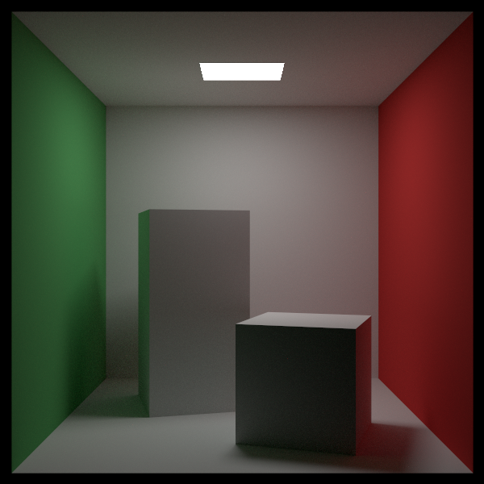
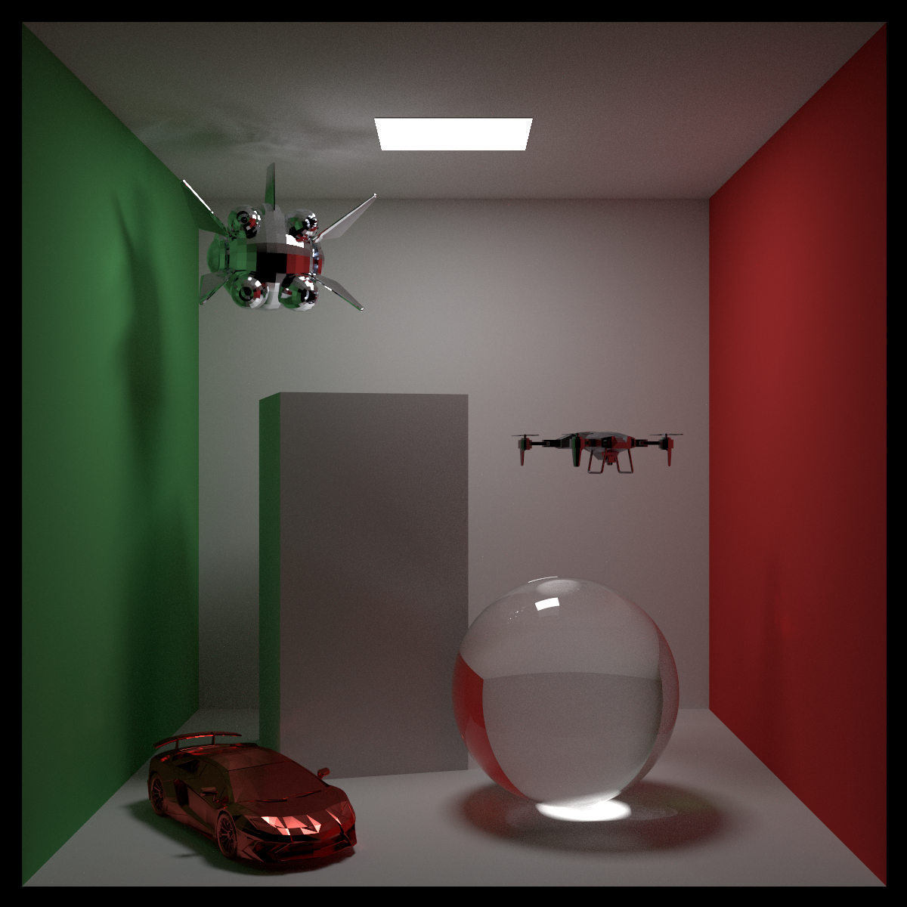
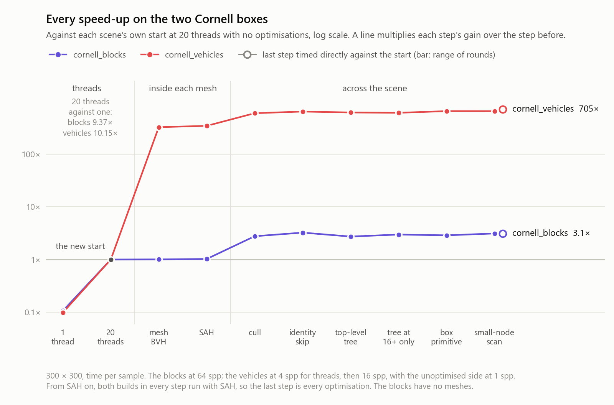
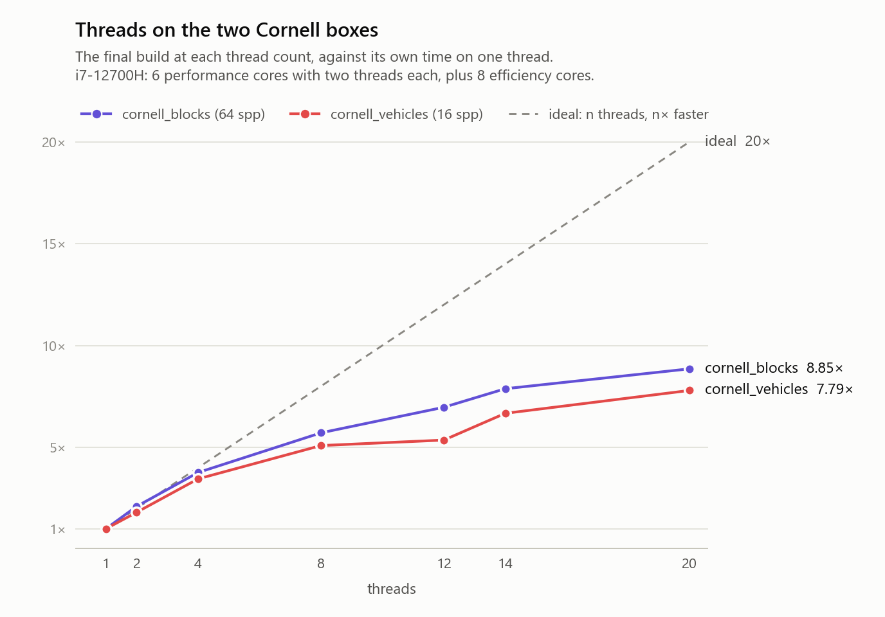

<!-- DATA NOTES, not prose. Every number below is computed from rows, or
quoted from ROADMAP where no rows exist (marked "ROADMAP"). Regenerate with:

  python scripts/nw10_summary.py           (every session, by CSV line)
  python scripts/speed_overlay_figure.py   (the overlay graph and its table)
  python scripts/speed_threads_figure.py   (the thread curve and its table)
  python scripts/speed_times_figure.py     (the measured times and their table)

Only the two Cornell boxes, through their 300² `_small` scenes.

Machine: i7-12700H, 6 P-cores with 2 threads each + 8 E-cores = 20 threads.
Every ladder number is at 20 threads unless it says otherwise. -->

::: {#fig-cornell-boxes layout-ncol=2 layout-valign="top"}
{width="100%" fig-alt="A square room with a green wall on the left, a red wall on the right and white walls, floor and ceiling, lit by a square lamp in the ceiling. A tall white block stands at the back left and a short white cube at the front right."}

{width="100%" fig-alt="A square room with a green wall on the left and a red wall on the right. A chrome spaceship hangs near the ceiling at the upper left, a small dark drone hovers at the right, a red sports car sits on the floor at the front left, and a tall grey block and a clear glass ball stand in the middle, the ball focusing the lamp into a bright spot on the floor."}

The Cornell box with two blocks, and the one with vehicles. Car: "[CAR Model](https://poly.pizza/m/5zUWP5UsLg-)" by Ignition Labs, [CC BY 3.0](https://creativecommons.org/licenses/by/3.0/). Drone: "[Drone](https://poly.pizza/m/DNbUoMtG3H)" by NateGazzard, [CC BY 3.0](https://creativecommons.org/licenses/by/3.0/). Spaceship: "[Spaceship](https://poly.pizza/m/u105mYHLHU)" by Quaternius, [CC0](https://creativecommons.org/publicdomain/zero/1.0/). Both CC BY models are rendered with plain materials in place of their own.
:::

The images above show two different Cornell boxes that I want to speed up. In my experience, premature optimization can be a problem: you keep shaving off time here and there and never get anything done. Don't optimize until you can see it's a problem. Well, it officially became one: I'm trying to shoot 20,000 samples per pixel. Now I need to make it fast.

## The result

<!-- STRUCTURE: result first. Keep this section short: the overlay
graph, the two headline numbers (68.4 s -> 10.6 ms a pass, every
image byte-identical) and "one change did almost all of it". The
tables below can move to the end if it gets long. -->

::: {#fig-results}
{fig-alt="A line chart on a log axis with two lines over ten steps. Both start together near 0.1× at one thread and meet at 1× at twenty threads. The vehicles' line jumps to about 320× at the mesh BVH step, rises to about 600× at the cull step and stays nearly flat to the end, where a ring marks 705×. The blocks' line stays at 1× through the two mesh steps, rises to about 3× at the cull step, dips at the top-level tree and ends near 3×, where a ring marks 3.1×."}

Every speed-up on the two Cornell boxes, showing every optimization from one thread to the small-node scan.

::: 

| Step | `cornell_blocks` this step | `cornell_blocks` total | `cornell_vehicles` this step | `cornell_vehicles` total |
|---|---|---|---|---|
| 1 thread |  | 0.107× |  | 0.0986× |
| 20 threads | 9.37× | 1× | 10.1× | 1× |
| mesh BVH | 1.01× | 1.01× | 323× | 323× |
| SAH | 1.02× | ≈1.02× | 1.06× | ≈342× |
| cull | 2.7× | ≈2.77× | 1.74× | ≈593× |
| identity skip | 1.17× | ≈3.24× | 1.08× | ≈638× |
| top-level tree | 0.842× | ≈2.72× | 0.96× | ≈612× |
| tree at 16+ only | 1.09× | ≈2.98× | 0.986× | ≈604× |
| box primitive | 0.966× | ≈2.88× | 1.08× | ≈650× |
| small-node scan | 1.08× | ≈3.12× | 0.999× | ≈649× |
| last step, timed directly against the start |  | 3.1× |  | 705× |

: Each step's own gain, and the running total measured against 20 threads with no other optimizations. {#tbl-steps}

<!--
{fig-alt="A log-scale chart of time per pass, from under 10 ms to over a minute, with a pair of dots joined by a stem for each scene at each of ten steps. The vehicles' stems are long at the threads step, 68 s to 6.5 s, and at the mesh BVH step, 6.7 s to 21 ms; after that every dot sits between about 5 and 20 ms. The blocks start at 129 ms on one thread, fall to about 14 ms with threads and to about 5 ms at the cull step, and stay there. A last pair, set apart, shows each whole ladder in one session: the vehicles 7.6 s to 10.6 ms, the blocks 14.9 ms to 4.74 ms."}

<!-- DATA NOTES for the measured-time graph. Regenerate the figure and this
table with `python scripts/speed_times_figure.py`.

- Per pass: each session's median render ms ÷ its spp, so the sessions at
  64, 16, 4 and 1 spp share one axis. Same sessions as the overlay graph.
- Each step's two medians come from its own session. The same build in two
  sessions can differ by a few percent (the blocks' `before`: 13.5 ms per
  pass in the mesh BVH session, 14.5 ms in the SAH session), so the figure
  never joins one session to the next, and a step's gain is the paired
  number in the overlay's table, not the ratio of these medians.
- Log scale: the times span four orders of magnitude, 4.74 ms to 68.4 s,
  and an equal speed-up is an equal drop at any height. -->

<!-- | Step | `cornell_blocks` older → newer, per pass | `cornell_vehicles` older → newer, per pass |
|---|---|---|
| 1 → 20 threads | 129 ms → 13.8 ms (64 spp) | 68.4 s → 6.54 s (4 spp) |
| mesh BVH | 13.5 ms → 13.5 ms (64 spp) | 6.7 s → 20.8 ms (1 → 16 spp) |
| SAH | 14.5 ms → 14.2 ms (64 spp) | 19 ms → 17.8 ms (16 spp) |
| cull | 14.7 ms → 5.45 ms (64 spp) | 18.3 ms → 10.6 ms (16 spp) |
| identity skip | 5.44 ms → 4.68 ms (64 spp) | 10.9 ms → 10 ms (16 spp) |
| top-level tree | 4.48 ms → 5.37 ms (64 spp) | 9.26 ms → 10.1 ms (16 spp) |
| tree at 16+ only | 5.25 ms → 4.91 ms (64 spp) | 9.75 ms → 10.4 ms (16 spp) |
| box primitive | 4.82 ms → 4.91 ms (64 spp) | 10.4 ms → 9.41 ms (16 spp) |
| small-node scan | 5.21 ms → 4.83 ms (64 spp) | 10.2 ms → 10.2 ms (16 spp) |
| all at once | 14.9 ms → 4.74 ms (64 spp) | 7.63 s → 10.6 ms (1 → 16 spp) | -->

<!-- | | Blocks (`cornell_blocks`) | Vehicles (`cornell_vehicles`) |
|---|---|---|
| Small image | 300², 64 spp | 300², 4 spp; 16 spp for "all" |
| No optimisations, 1 thread | 8,225 ms | 273,584 ms (4 min 34 s) |
| No optimisations, 20 threads | 880 ms, **9.37×** (9.22–9.63) | 26,141 ms, **10.15×** (9.49–10.64) |
| All optimisations with SAH, 20 threads | 303 ms, a further **3.10×** (2.67–3.57) | 170 ms at 16 spp, a further **705×** per sample (656–756) |
| 1 thread with none → 20 threads with all | **≈28×** | **more than 6,000×** | 
| Big image, current build, 20 threads | 600², 20,000 spp: 400,891 ms (6 min 41 s) | 1200², 20,000 spp: ≈57 min |

-->

### A few things stand out straight away

- **Threads help both scenes about equally:** 9.37× for the blocks and 10.1× for the vehicles.
- **The mesh BVH only matters where there are meshes.** It speeds `cornell_vehicles` up 323×, because the vehicles are built from triangles, and leaves `cornell_blocks` unchanged at 1.01×, because the blocks have no triangles to search.
- **Culling is the other clear gain:** 2.7× for the blocks and 1.74× for the vehicles.
- **Every other step moves things by less than 20%,** and the top-level tree actually slows both scenes down. The rest of the article looks at why.

## The cost

{#fig-cornell-blocks width="100%" fig-alt="A square room with a green wall on the left, a red wall on the right and white walls, floor and ceiling, lit by a square lamp in the ceiling. A tall white block stands at the back left and a short white cube at the front right."}

" by Ignition Labs, [CC BY 3.0](https://creativecommons.org/licenses/by/3.0/). Drone: "[Drone](https://poly.pizza/m/DNbUoMtG3H)" by NateGazzard, [CC BY 3.0](https://creativecommons.org/licenses/by/3.0/). Spaceship: "[Spaceship](https://poly.pizza/m/u105mYHLHU)" by Quaternius, [CC0](https://creativecommons.org/publicdomain/zero/1.0/). Both CC BY models are rendered with plain materials in place of their own.](../docs/images/bvh/speed-cornell-vehicles.png){#fig-cornell-vehicles width="100%" fig-alt="A square room with a green wall on the left and a red wall on the right. A chrome spaceship hangs near the ceiling at the upper left, a small dark drone hovers at the right, a red sports car sits on the floor at the front left, and a tall grey block and a clear glass ball stand in the middle, the ball focusing the lamp into a bright spot on the floor."}

<!-- DATA NOTES: `assets/scenes/cornell_blocks.lua` with RT_MIXTURE=1
RT_SPP=20000 (half of each diffuse bounce aimed at the lamp), 20 threads,
`build/raytracer.exe`, rendered 12 November: 400,891 ms (6 min 41 s),
one run (CSV line 301), so a few percent either way on this laptop. The scene's own
setting is 200 spp, BSDF sampling only; the numbers below are at that
setting. -->

A render's time is the number of pixels, times the samples per pixel, times what each sample costs. The two final images above push the first two factors as far as I took them: 20,000 samples per pixel, at 600² for the blocks and 1200² for the vehicles. Here is what they took with every optimization, and what they would have taken with none:

| | `cornell_blocks` | `cornell_vehicles` |
|---|---|---|
| Image | 600², 20,000 spp | 1200², 20,000 spp |
| Samples traced | 7.2 billion | 28.8 billion |
| No optimizations, 1 thread (estimate) | ≈2.9 hours | ≈250 days |
| All optimizations, 20 threads | 6 min 41 s | ≈57 min |
| Gain | ≈26× | ≈6,400× |

: What the two final renders took with every optimization, against an estimate for one thread with none. {#tbl-cost}

The gains in @fig-results come from small 300² renders, which keep each run to seconds so I can repeat it many times. Because time grows with pixels × samples, a step that makes the small image 2× faster makes the big one 2× faster too. So once each step had proven itself on the small images, I spent the gains on the big ones and rendered as much as I could. For a CPU, these numbers aren't bad, but the next big jump is probably porting to a GPU.

From the estimates, I'd say the optimizations came at the right time. Nobody waits 250 days for a picture, but 57 minutes is a lunch break. For the rest of the article, I'll explore what each optimization is and how much time it saved.

<!-- DATA NOTES for the estimate and gains.
- Per pass, 1 thread, no optimisations: blocks 8,225 ms / 64 spp = 129 ms;
  vehicles 273,584 ms / 4 spp = 68.4 s (300², overlay sessions).
- Blocks: 129 ms × 4 × 20,000 = 10,281 s ≈ 2.86 h; / 400.9 s ≈ 25.6×.
  Vehicles: 68.4 s × 16 × 20,000 = 21.9 M s ≈ 253 days; / 3,429 s ≈ 6,380×.
- Vehicles' 57 min is scaled from one 1,000 spp run (171,457 ms × 20); the
  20,000 spp render itself wasn't timed. Time is linear in spp.
- Both big renders ran with RT_MIXTURE=1, which changes the image, so they
  are timed, not compared, and cost more per sample than the estimate's side.
- Step-by-step figures use the overlay's running totals × the threads gain:
  blocks /9.37 = 18.3 min, × cull (2.77 total) = 6.6 min; vehicles /10.1 =
  25 days, mesh BVH (323) = 1.9 h, cull (593) = 61 min.
- Small-image end to end: blocks 9.37 × 3.10 ≈ 29× paired, ≈27× on medians;
  vehicles 10.15 × 705 ≈ 7,200× paired, ≈6,400× per sample on medians. -->

## Threads

The first thing I can change is the number of threads. Until now, everything ran on one thread, so one core did all the work while the rest of the CPU sat idle. My laptop can run up to 20 threads at once.

A ray tracer is about as easy to split as work gets. Every pixel is computed on its own: no pixel waits for its neighbour. So I cut the image into horizontal bands, one band of rows per thread, and let every thread work on its own band at the same time. Think of Jason (yes, I have played some GTA 6) painting the walls for Lucia. By himself, he gets it done eventually. With 20 Jasons (lucky Lucia), each with their own stretch of wall, the job finishes far sooner, as long as nobody has to wait for anyone else.

However, some Jasons finish earlier than others. That's another opportunity for optimization, but it's easy to fall into the never-done trap, so it will have to wait until much later.

I rendered both boxes on 1 thread, then 2, 4, 8, 12, 14 and 20, and timed each one. These runs use the final build, with every optimization in this article turned on, so the 20-thread numbers below differ from the 9.37× and 10.1× in @tbl-steps, which were measured on the build with none:

| Threads | 1 | 2 | 4 | 8 | 12 | 14 | 20 |
|---|---|---|---|---|---|---|---|
| `cornell_blocks` (64 spp) | 1× | ≈2.10× | ≈3.76× | ≈5.71× | ≈6.97× | ≈7.88× | **8.85×** |
| `cornell_vehicles` (16 spp) | 1× | ≈1.81× | ≈3.45× | ≈5.09× | ≈5.35× | ≈6.67× | **7.79×** |

: The final build's speed-up over one thread, at each thread count. {#tbl-threads}

{#fig-threads fig-alt="A line chart of speed-up against thread count. A dashed ideal line rises straight to 20× at 20 threads. Two coloured lines follow it closely to 4 threads, then bend away and end near 9× and 8×."}

<!-- DATA NOTES: `python scripts/speed_threads_figure.py` draws the figure
and prints the table. Share of ideal at 20 threads: the blocks 44%, the
vehicles 39%; at 2 threads, 105% and 90%. The blocks' 2.10× spans
1.92–2.23 across the two sessions' rounds, so call it 2×. The image
depends on the thread count, so no hash gates these runs. -->

Notice the sample counts: 64 and 16 per pixel on a 300² image, nowhere near the 20,000 per pixel at 600² and 1200² in @fig-cornell-blocks and @fig-cornell-vehicles. That's on purpose. Every timing has to be repeated many times to be trusted, and long runs also give the laptop time to heat up and slow down. So I keep the images small and the runs short, and since render time grows with pixels × samples, the speed-ups carry over to the big images unchanged. The sample counts will climb as the next optimizations land.

### Why it is not ideal

**Not all 20 threads are equal.** My CPU is an i7-12700H, with 6 fast performance cores and 8 slower efficiency cores. Each performance core runs two threads, while each efficiency core runs one. That gives 12 threads across 6 cores and 8 threads across 8 cores. So 20 threads is really 14 cores of two different speeds, and the threads I add last are the weakest.

**One core alone runs faster.** With only one core busy, the chip can push that core to its top speed. With every core busy, the power and heat are shared across all of them, so each core runs slower, even though together they get more done.

**The laptop throttles.** A laptop can't cool itself as well as a desktop. When the chip gets too hot, it lowers its own clock speed to protect itself, so every core does less work each second. With all 20 threads busy, it heats up faster and slows down sooner. I also had other applications open, which take a share of the cores and add their own heat.

Ultimately, being about 8 times faster may not be ideal, but it is an overall improvement.

## The mesh BVH

This gave us the biggest gain of the whole article: 323× on `cornell_vehicles`, and 1.01× on `cornell_blocks`, which is no change at all (@tbl-steps). On 20 threads, one pass over the small vehicles image went from 6.7 s to about 21 ms. That one step is most of the ≈6,400× in @tbl-cost.

That isn't surprising once you see what a BVH does.

**What a BVH is.** To find what a ray hits, the simplest approach is to test it against everything in the scene, one by one. A bounding volume hierarchy (BVH) avoids that by putting things in boxes. Nearby objects share a box, nearby boxes share a bigger box, and so on, up to one box around the whole scene. A ray tests the big box first. If it misses, everything inside is skipped with a single test. If it hits, the ray checks the smaller boxes inside and only goes further into the ones it hits. It works like looking up a word in a dictionary: you jump to the right letter instead of reading every page.

**Why it needs to reach inside meshes.** *Ray Tracing: The Next Week* builds its BVH over whole objects. A mesh like the car in @fig-cornell-vehicles counts as one object, even though it is made of thousands of triangles. So the tree could lead a ray to the car, but then the ray still tested every triangle in it, one by one. The mesh BVH builds a second tree inside each mesh, so a ray that reaches the car only tests the few triangles near where it lands.

**Why the vehicles gained so much and the blocks so little.** The vehicles are made of meshes. Without the mesh BVH, each ray tested 21,024 triangles; with it, about one. The frame got 323× faster rather than thousands of times, because once the triangle tests were gone, shading and bouncing took up most of the time. The blocks have no meshes, only flat quads, so the mesh BVH had nothing to speed up.

### SAH

The first tree split each box's triangles at the middle one, so each half got the same number. That's simple, but it ignores how big the boxes end up. A ray is more likely to hit a big box than a small one, so a split that leaves one huge box and one tiny one makes rays do more work. The surface area heuristic (SAH) weighs that: it tries several places to cut and keeps the one where each side's surface area times its number of triangles is lowest. That lowers the overall cost of walking the BVH.

On the vehicles it cut triangle tests per ray by a third, but the frame only got 1.06× faster (@tbl-steps). That's why I stopped there. After the mesh BVH a ray tests about one triangle, so making that one test rarer can't save much. The time had moved somewhere else: the very next step, culling, gave the vehicles 1.74×, far more than SAH did.

<!-- DATA NOTES for the mesh BVH build (kept from the longer draft). -->
<!-- DATA NOTES:

- The vehicles' before-numbers, 13 November, linear scan, 20 threads:
  6,698 ms for one sample per pixel (median of 5), 46.6 k rays/s; 21,024
  triangle tests per ray (6,569,032,896 for 312,454 rays, the same in both
  counting runs).
- Gate: the new binary's linear path had to reproduce the old triangle
  counts to the digit. The counts are deterministic, so any other figure
  means the plumbing changed the path it measures.
- What instrumenting found (small fixes, found on step 8's test scenes;
  ROADMAP step 8 "Issues and fixes"; not repeatable on today's builds):
  - One shared `fetch_add` per counter per call made counting several times
    slower than the render; per-thread tallies still cost (MinGW emulates
    `thread_local` with a function call), so counting became opt-in.
  - Flushing the tallies from a `thread_local` destructor gave wrong totals in
    18 of 30 runs; an explicit flush gave 30 of 30.
  - `NonhierBox` ran `std::call_once` on every test, and the profiler found
    worker time in locks; removing it was faster in every round, images
    byte-identical.
  - The background PNG was decoded inside the render timer on every call: a
    fixed cost per frame.
  - The specular shadow-ray guard went in **before** the baseline, so the
    tree couldn't take credit for it: fewer triangle tests, byte-identical,
    and a counter saw it where the clock couldn't.
  - Before the staircase: the background passed by value, byte-identical
    when fixed. *(ENGINEERING lists this under part 7's bug collection;
    pick one home.)*
-->
<!-- DATA NOTES:

- Longest axis, split by count at the median centroid, so coincident
  centroids can't stall it. `std::nth_element` instead of `std::sort`:
  prediction "build time falls by a third to a half". The sort is gone from
  today's builds, so that comparison can't be re-run on the vehicles.
- The vehicles' three meshes build in 4.16 ms with the median split
  (median of 5 runs, CSV lines 423–432).
- Checkpoint with `AABB::Hit()` still returning `true`: every triangle tested
  once per ray, so the tree's count must equal linear's to the digit. Counts
  passed, but the unculled tree was slower than the scan for the same tests
  (step 8's test scenes): the scan inlines the triangle test and the tree
  calls it out of line (`-flto` closed part of the gap), and the walk itself.
-->
<!-- DATA NOTES:

- Slab test with a precomputed `1/dir`, no normalisation (the renderer's `t`
  must mean the same everywhere); `t_best` tightened on every accepted hit.
- Linear against the tree, one build (`before`), 20 threads, 5 rounds,
  13 November (CSV lines 303–312, 601–610):

| Scene | linear | tree | rays/s | speed-up per sample |
|---|---|---|---|---|
| `cornell_vehicles` | 6,698 ms at 1 spp | 332 ms at 16 spp | 46.6 k → 15.0 M | **323×** (286–349), 5/5 |
| `cornell_blocks` | 862 ms at 64 spp | 861 ms at 64 spp | 21.8 M → 21.8 M | 1.01× (0.97–1.03), no meshes |

- Triangle tests per ray on the vehicles: 21,024 → 1.07, about 19,600×
  fewer, while the frame got 323× faster. Nodes visited per ray: 8.64.
  (Counting runs at 1 spp, CSV lines 595–600.)
-->
<!-- DATA NOTES:

- *Your note:* you enjoy writing the iterative one more. The ROADMAP backs it
  up: the plan said recursive first, as the reference, and the iterative
  traversal was written first anyway; the recursive one followed on
  5 October.
- Prediction, written 5 October before any timing: iterative is faster,
  because its explicit stack replaces a call frame per node. No magnitude.
- Result, `rung4b`, 20 threads, 5 rounds, 13 November (CSV lines
  393–412, 503–522). Recursive time ÷ iterative time, so above 1 means
  iterative is faster (rounds iterative won):

| Scene | median split | SAH split |
|---|---|---|
| `cornell_vehicles` (16 spp) | **1.09** (1.06–1.12), 5/5 | 0.984 (0.91–1.03), 3/5 |
| `cornell_blocks` (64 spp, no meshes) | 1.01 (0.98–1.05), 2/5 | 0.982 (0.90–1.06), 3/5 |

- On the vehicles with the median split, iterative was 9% faster in every
  round; with SAH there's no measurable difference. The blocks have no
  meshes, so neither traversal runs: their row is the noise floor. Not
  explained yet; the profiler wasn't run on these scenes.
- The gate that makes it clean: same child order, so both visit the same nodes
  and test the same triangles. Counts equal **to the digit**, images hash the
  same; only the clock may differ.
- The disassembly: GCC keeps only half the recursion. The near-child call is a
  real `call`; the far-child call, in tail position, became a jump. So one
  call per interior node, which the return-address predictor handles well.
  The time is the work at each node (two child boxes, six slab planes each),
  not how the next node is reached.
-->
<!-- DATA NOTES:

- Front to back: each node stores its split axis, and the child on the ray's
  side goes first. (Step 8's test scenes; the old order is gone from today's
  builds.)
- SAH, binned, 16 bins per axis, iterative, `before`, 20 threads, 5 rounds,
  13 November (CSV lines 313–322, 423–432; counts 595–600):

| Scene | triangles/ray, median → SAH | nodes/ray | median ÷ SAH time | SAH won |
|---|---|---|---|---|
| `cornell_vehicles` | 1.073 → 0.734 (−31.6%) | 8.64 → 6.65 (−23.1%) | **1.06×** (1.00–1.12) | 5/5 |
| `cornell_blocks` | no meshes | | 1.02× (1.00–1.03) | 4/5 |

- SAH builds slower: the vehicles' meshes 4.16 → 8.06 ms (medians of 5).
  Its images are byte-identical to the median split's.
- **Why you stopped at SAH (the data for it):** after the median tree a
  vehicles ray tests 1.07 triangles and visits 8.6 nodes; SAH cuts the
  triangles by a third and the frame by 6%. The linear scan's 21,024 tests
  per ray became about one, while the frame got 323× faster, not 19,600×:
  the triangle tests are no longer where the time is. The next step,
  culling, gave the vehicles 1.74×, more than SAH did: the time had moved
  to the scene graph. (No profile of these scenes.)
-->

## Why the rest were small

After the mesh BVH, most of what was left wasn't triangles. So each step after it could only speed up a small slice of the time, and a big gain on a small slice is a small gain overall. Culling is the one exception, because it went after where the time actually was: the scene graph.

### Culling

A scene in my ray tracer is a tree of nodes. Each node has its own position, rotation and scale (a matrix), and holds shapes or more nodes. Each block in `cornell_blocks` is one node with six quads under it. Before culling, a ray reaching a node was moved into that node's space with the matrix and then tested against every shape inside, whether it came anywhere near them or not.

Culling puts a box around each child and tests the ray against that box first. If the ray misses the box, it skips the child entirely, so the matrix and everything inside are never touched. For a block, one box test now replaces a matrix and six quads for every ray that misses it, and most rays miss most blocks.

That gave both scenes a big jump: 2.7× for the blocks and 1.74× for the vehicles.

### The rest

The other steps each moved things by less than 20%. Skipping the matrix maths for nodes that aren't moved gave a little. A tree over each node's children made the blocks slower, since a handful of children is quicker to test in order, so it now only kicks in at 16 or more. The rest landed within noise: on these two scenes there just wasn't much time left to save.

<!-- DATA NOTES for the ladder after the mesh BVH (kept from the longer draft). -->
<!--
Next Week 10's ladder on the two Cornell boxes, 13 November, 20 threads,
paired, 5 rounds, every build with `BVH_SPLIT=sah`; the blocks at 64 spp,
the vehicles at 16 spp (CSV lines 323–382, 433–492). "This rung" is
against the rung before (rounds faster); "total" is against the start (20
threads, no optimisations), multiplied along, so "≈".

| Rung | blocks this rung | blocks total | vehicles this rung | vehicles total | Image |
|---|---|---|---|---|---|
| 2 Cull | **2.70×** (2.58–2.80), 5/5 | ≈2.77× | **1.74×** (1.69–1.76), 5/5 | ≈593× | same |
| 2b Identity skip | **1.17×** (1.04–1.32), 5/5 | ≈3.24× | 1.08× (1.00–1.22), 5/5 | ≈638× | same |
| 3 Top-level tree | **0.842×** (0.81–0.90), 0/5, slower | ≈2.72× | 0.96× (0.82–1.08), 2/5 | ≈612× | same |
| 3b Tree at 16+ children | 1.09× (1.00–1.24), 4/5 | ≈2.98× | 0.986× (0.91–1.12), 2/5 | ≈604× | same |
| 4 Box primitive | 0.966× (0.90–1.00), 0/5 | ≈2.88× | 1.08× (0.99–1.22), 4/5 | ≈650× | same |
| 4b Small-node scan | 1.08× (1.02–1.22), 5/5 | ≈3.12× | 0.999× (0.93–1.11), 2/5 | ≈649× | same |
| Direct, start → 4b | | **3.10×** (2.67–3.57) | | **705×** (656–756) | same |

- The vehicles' totals include the mesh BVH (323×) and SAH (1.06×) before
  rung 2; the blocks' include those two steps' noise (1.01× and 1.02×).

### Culling

- Slab-test a child's bounds before calling its `IsHit`. Still linear, but a
  miss costs one box test instead of six quads and a matrix.
- The blocks **2.70×**, the vehicles **1.74×**, 5 of 5 rounds each, images
  byte-identical. Each block is six quads under its own node, so a ray
  that misses a block's box now skips all six.

### The top-level tree

- A median-split tree over the children's bounds, both children visited left
  first (not nearer first, not SAH).
- The blocks **0.842×, slower**, 0 of 5 rounds faster; the vehicles 0.96×
  (0.82–1.08), inside noise. Images byte-identical: neither scene has a
  medium, so the new test order changes nothing. Not profiled.
- Rung 3b: a tree only for 16 or more children; fewer are tested in list
  order. Neither Cornell box has a node with 16 children (the blocks' root
  has 8 and each block 6; the vehicles' root has 11), so from 3b on neither
  builds a top-level tree. The blocks get 1.09× back (4 of 5 rounds); the
  vehicles 0.986×, noise.

### The rest

#### Bounds

- Rung 1: `Bounds()` on every primitive and node, in the node's own space; a
  node's box is its children's union carried through its matrix (all eight
  corners). A unit test per type fires random rays and asserts every hit
  lies inside the bounds. Not benched: nothing called it yet. All 18
  baseline renders byte-identical.

#### The identity skip

- The blocks **1.17×** (1.04–1.32), the vehicles 1.08× (1.00–1.22), 5 of 5
  rounds each, images byte-identical.

#### The box primitive

- A new `gr.box`: one slab test instead of six quads. Neither Cornell box
  uses it: the blocks are built from quads.
- The blocks 0.966× (0.90–1.00, 0 of 5 rounds faster), the vehicles 1.08×
  (0.99–1.22, 4 of 5). Neither scene calls `gr.box`, so this rung can only
  show the new code's cost, or noise.
- A `box_test` (box against the six quads, from outside and from inside as a
  medium asks) fails on a flipped normal and on a dropped exit hit.

#### The small-node scan

- 4b wrote the small-node scan as rung 2's plain loop again and moved the
  tree walk into its own function.
- The blocks 1.08× (1.02–1.22, 5 of 5), the vehicles 0.999× (2 of 5). On
  the blocks, rungs 3 to 4b together come to 0.842 × 1.09 × 0.966 × 1.08
  ≈ 0.96×: they leave the blocks about where rung 2b had them.
-->

## What's next

There is still plenty left to try on the CPU:

- **Better work sharing between threads.** Some threads finish their band early and sit idle. Cutting the image into small tiles instead of bands should keep every thread busy to the end.
- **A tighter BVH layout.** Smaller nodes that fit the CPU's cache better, and wider nodes with four or eight children tested at once.
- **Fewer samples for the same picture.** Sampling the lights directly and adding a denoiser would get a clean image with far fewer samples per pixel.
- **The GPU.** Once the CPU work is done, porting to the GPU is the next big jump.

## What I do now

Making it fast taught me as much about measuring as about optimizing. These are the habits I keep:

- **Measure the before and the after together,** in the same session, alternating the two, because the laptop's speed drifts.
- **The picture must not change.** A speed-only change has to produce a byte-identical image, or it isn't a speed-only change.
- **Count as well as time.** Counts like triangle tests per ray come out the same on every run, so they catch changes the clock is too noisy to see.
- **Write the prediction down first.** I was wrong several times, and each time that was the most useful thing I learned.
- **Keep runs short.** Small images and few samples, so every timing can be repeated and the laptop doesn't heat up mid-run.

<!-- DATA NOTES: the longer drafts of "What's next" and "What I do now". -->
<!--
## What's next

The techniques that come next, with what each is expected to buy, from the
ROADMAP:

- **Tiles** instead of scanline bands, the `Rng` seeded per pixel: targets
  band imbalance between threads, and makes the image the same at any
  thread count.
- **The BVH layout** (each to be predicted first and benched at 1 and 20
  threads):
  - test the children at the parent, so only nodes known to be hit are
    popped;
  - a 32-byte node, two per 64-byte cache line (now 44 bytes, so a node often
    straddles two lines);
  - leaf-ordered triangles: a 4-triangle leaf in 2–3 consecutive lines
    instead of up to five scattered reads;
  - a wide BVH, 4 or 8 children per node, with a SIMD slab test (this machine
    has AVX2), so a shallower tree. This is the shape Embree builds and
    Cycles traverses on the CPU.
- **The top-level tree's own SAH, nearer-first order and threshold:** left
  untuned.
- **Fewer samples for the same noise** (a different metric, time to a noise
  level, so not in this post): stratified samples, NEE for the area lights,
  a denoiser (Intel Open Image Denoise), adaptive sampling.
- **Smaller ones:** a `kLeafSize` sweep (1–16); `-flto`; an iterative
  `Build()` (only if build time ever matters).
- **The GPU** (Vulkan ray queries): after the CPU work, not here.

## What I do now

- The methods that made each number trustworthy:
  - re-take the before-number beside the after, in one session, paired ABBA,
    geometric mean of per-round ratios, median over 5 rounds;
  - byte-identical images as the pass condition for a speed-only change;
  - deterministic counters beside the clock, counted in a separate run;
  - the prediction written before the measurement (wrong several times, and
    that was the finding);
  - a profiler when the numbers need explaining (here a 120-line sampler,
    because nothing on the machine could read MinGW symbols);
  - separate the fixed per-frame cost from the per-ray cost before comparing
    at low spp;
  - bench each commit from its own worktree, so no other build replaces the
    binary mid-run;
  - every number with its scene, resolution, spp and thread count.

-->

## References

- Peter Shirley, Trevor David Black, Steve Hollasch, *Ray Tracing: The Next
  Week*, <https://raytracing.github.io/>.
- Matt Pharr, Wenzel Jakob, Greg Humphreys, *Physically Based Rendering*,
  4th ed., the BVH chapter (binned SAH, `LinearBVHNode`),
  <https://pbr-book.org/>.