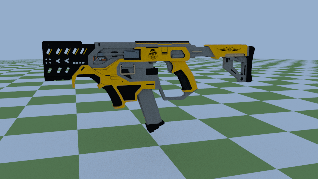
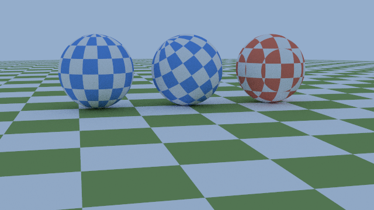
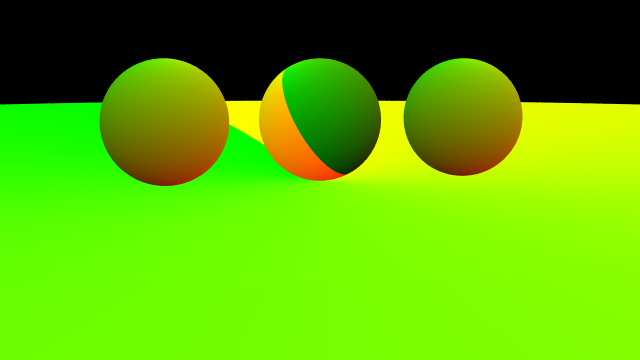
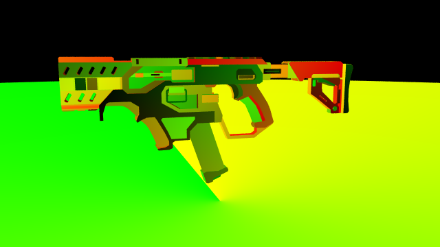
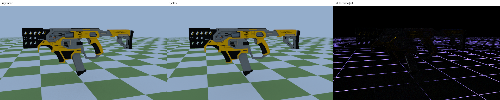
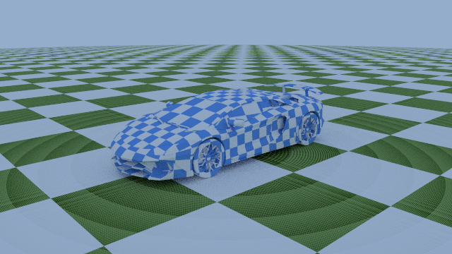
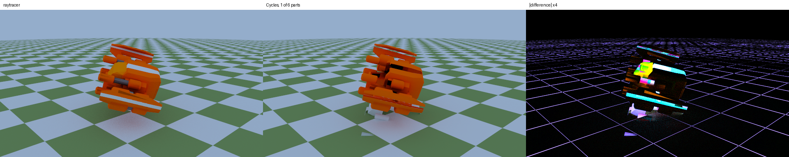

<!-- DRAFT. Part 5 of the series. Numbers from docs/ROADMAP.md, step 9 (the
     exit, 9 October). Rewrite in your own voice: the structure and the
     numbers are the part to keep. -->

{fig-alt="A yellow, grey and black stylised gun floating over a green and white checkered floor under a pale blue sky."}

This is a model off Sketchfab, wearing its own 4096 × 4096 texture, rendered
in the path tracer I'm building. Blender rendered the same scene too. On
average, the two disagree by two hundredths of one colour level.

## What has to be true

A texture lands in the right place if two things hold at every hit:

- $P$: **the hit knows where it is on the surface.** Its $(u, v)$, the
  coordinates that say which point of the image belongs here, is right.
- $Q$: **the image is read the right way.** Right way up, right way round,
  and in linear light, not the sRGB the PNG is stored in.
- $R$: **the render matches a renderer I trust**, given the same scene.

$$
P \wedge Q \Rightarrow R
$$

Cycles is the renderer I trust. So if mine matches it, both $P$ and $Q$ are
doing their jobs, and if it doesn't, the difference image shows which one
broke: a wrong $(u, v)$ moves whole decals, a flipped image mirrors them, and
a missing sRGB decode washes everything out.

## Painting from space, then painting the surface

*Ray Tracing: The Next Week* starts with a checker cut from space: the colour
depends only on where the hit point is, no $(u, v)$ needed. It's perfect for a
floor. On a sphere, it slices the cells unevenly, because the cubes don't care
about the surface.

{fig-alt="Three checkered spheres on a checkered floor. Two blue ones have neat cells following the sphere; the red one on the right has cells cut at odd angles."}

The fix is $P$: give every hit its $(u, v)$. For a sphere, that's longitude and
latitude. The debug view that paints $u$ as red and $v$ as green makes it
visible, seam and all:

{fig-alt="The three spheres shaded in smooth red-green gradients instead of checkers."}

## Reading an image

An image texture is a lookup: $(u, v)$ in, colour out. Two things went into
$Q$:

- **Which way is up.** Image rows run top to bottom; $v$ runs bottom to top.
  A test image with a different colour in each quadrant pins that down, and a
  unit test holds it there.
- **Linear light.** A PNG stores sRGB, which is brightness curved for screens.
  My renderer works in linear light, so each texel is decoded once, on load.

{fig-alt="Two spheres: one with a four-coloured test grid, one showing Jupiter's banded clouds."}

<!-- VOICE: the Jupiter map is 170 MB and not in git. Worth a line on the
     placeholder: a missing texture renders a grey-and-white checker instead
     of crashing (step9-03-missing-texture-placeholder.png). -->

## Meshes

A sphere can compute its $(u, v)$. A mesh can't: the artist decided it, and
the OBJ file stores it per corner, in `vt` lines. A hit inside a triangle
blends its three corners' $(u, v)$ by the barycentric weights the
intersection test already computes, so placing the hit on the triangle and on
the texture is the same arithmetic.

{fig-alt="The gun shaded in patches of red, green and yellow gradients."}

The unit test for it uses a point at (0.2, 0.7), not the centre, so swapping
the two weights gives a different answer. I swapped them on purpose to check:
the test fails.

## Matching Cycles

Blender rebuilds the same scene from a script: the same OBJ and PNG through
Blender's own importer, the same camera, a Diffuse BSDF on the texture
(Lambertian, like mine), the same checker floor, the same sky, and my tone
map applied to its output. Then a script compares the two.

{fig-alt="Two near-identical renders of the gun side by side, and a mostly black difference image with faint grid lines."}

| 256 samples per pixel | Mean colour (R, G, B) |
|---|---|
| My renderer | 116.28, 138.90, 142.72 |
| Cycles | 116.30, 138.92, 142.73 |

Mean absolute difference: 2.36 out of 255, and that's noise, not placement.
The difference image has no decals in it. What it does have is faint lines
along the checker edges, where two random samplers split a hard edge
differently, and texel edges on the gun, where a 4096-texel map is drawn at a
tenth of its size.

**What this doesn't claim.** Only the base colour is used. The model ships
normal, roughness and metal maps that my renderer can't use yet, so Blender
was told to ignore them too. It matches Cycles *given the same
simplification*, not the artist's full look.

## What went wrong on the way

**Rings on every floor.** I took them for the checker flipping between
layers. A debug view showing only the surface colour said otherwise: exactly
two colours, no rings. So the rings were *shading*. The floor is a sphere of
radius 1000, and in single precision a hit point that far out rounds to just
inside the surface, so bounce rays started in the floor and shadowed
themselves. Solving that sphere in double precision removed them.

{fig-alt="A checkered car on a checkered floor covered in fine concentric rings."}

**Blender painted one part out of six.** The first comparison had whole parts
missing. The ship's OBJ has six objects; Blender imports them separately, and
my script moved and painted only the first. My renderer reads the file as one
mesh. Joining the parts in the script fixed it, and the difference image
found it at once: whole shapes, not texels.

{fig-alt="Two renders of a cartoon spaceship and their difference, which shows large bright shapes where parts are missing."}

## Credits

- "SMG GUN Remastered" by [ROHIT3DMODELS](https://sketchfab.com/Rohit3Dasset),
  from [Sketchfab](https://sketchfab.com/3d-models/smg-gun-remastered-2e9bf758703847c88d854fa204384203),
  [CC-BY-4.0](http://creativecommons.org/licenses/by/4.0/). Rendered with its
  base-colour map only.
- "Cartoon spaceship" by [pinguinoconpulgares](https://sketchfab.com/pinguinoconpulgares),
  from [Sketchfab](https://sketchfab.com/3d-models/cartoon-spaceship-a377d653202f45a68d441a987aa6dbda),
  [CC-BY-4.0](http://creativecommons.org/licenses/by/4.0/).
- "Merged Cassini and Juno global map of Jupiter", processed by Björn
  Jónsson. Credit: NASA / JPL-Caltech / SSI / Southwest Research Institute / Malin Space Science Systems / Italian Space Agency (ASI) / Italian National Institute for Astrophysics (INAF) / JIRAM / Björn Jónsson,
  [CC BY 3.0](https://creativecommons.org/licenses/by/3.0/). Wrapped onto a
  sphere and rendered. [Source](https://www.planetary.org/space-images/merged-cassini-and-juno).
- "CAR Model" by Ignition Labs, from
  [Poly Pizza](https://poly.pizza/m/5zUWP5UsLg-),
  [CC BY 3.0](https://creativecommons.org/licenses/by/3.0/). Rendered with a
  checker in place of its own materials.
- Peter Shirley, Trevor David Black and Steve Hollasch,
  [*Ray Tracing: The Next Week*](https://raytracing.github.io/books/RayTracingTheNextWeek.html),
  chapter 4.

---

*From a path tracer I'm building in C++. Previously:
[the white furnace test](https://dev.to/ibukunsanni/apparently-bland-2d-grey-squares-are-important-to-my-3d-renderer-21fo).*
