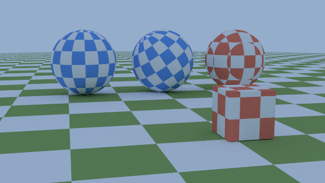
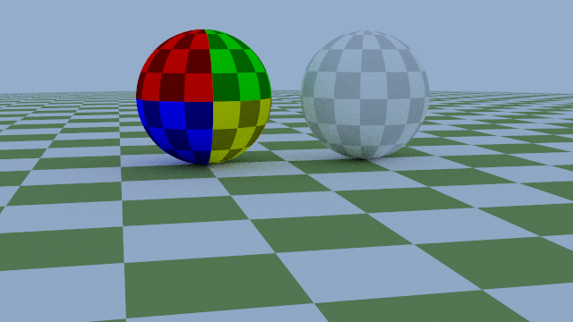
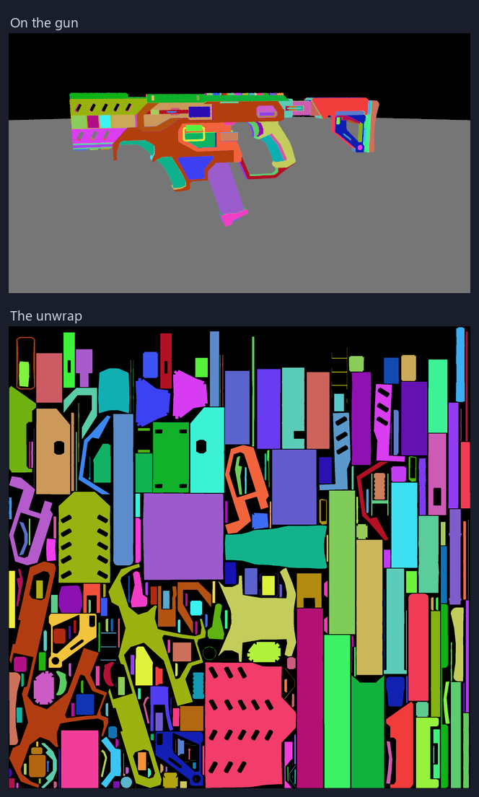
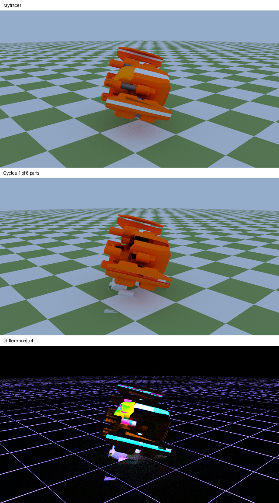

{fig-alt="A yellow, grey and black stylised gun floating over a green and white checkered floor under a pale blue sky."}

## What is a texture?

In my earlier explorations, every object in my renders had one material with a single color. A texture allows multiple colors across the surface of an object. It simply tells us what color is supposed to be at the ray's hit location. It can be as simple as a checkered pattern like a chessboard, like the floors in all of these images, or as complicated as the texture on the SMG above.

To wrap an image, each point on the surface needs to know where it sits on
that image. Since we are already using $(x, y, z)$ coordinates for the model, we adopt $(u, v)$ coordinates: two numbers from 0 to 1 that map a 2D image onto a 3D object.

::: {.callout-note title="Side bar: it keeps coming back to 2D"}
Rendering is already a 2D image made from a 3D scene. Then the
[white furnace test](https://dev.to/ibukunsanni/apparently-bland-2d-grey-squares-are-important-to-my-3d-renderer-21fo)
turned correctness into a flat grey square: if it's perfectly flat, energy is
conserved. [Malley's method](https://dev.to/ibukunsanni/a-hexagonal-aperture-would-break-every-diffuse-surface-in-my-renderer-3874)
picks 3D bounce directions by lifting points straight up off a flat 2D disk.
Now a texture runs the other way, taking a 2D image and putting
every pixel where it belongs on a 3D surface. I love it, and I am sure
there's more to come.
:::


We have to figure out a few things:

- where the $(u, v)$ comes from, for spheres and for meshes
- which way up the image is
- what color space it's stored in

## Painting from space, then painting the surface

Following *Ray Tracing: The Next Week*, we start with a checkered cut from space.
For a checkered cut from space it is simple: take the floor of $(x, y, z)$ and add them up. If the sum is even, use one color; if it's odd, use the other. In my case, yin and yang.

```cpp
glm::vec3 Value(float u, float v, const glm::vec3& p) const override {
  int x_int = static_cast<int>(std::floor(inv_scale_ * p.x));
  int y_int = static_cast<int>(std::floor(inv_scale_ * p.y));
  int z_int = static_cast<int>(std::floor(inv_scale_ * p.z));

  // Yin fills the cubes whose index sum is even, yang the odd ones.
  bool is_even = (x_int + y_int + z_int) % 2 == 0;

  return is_even ? yin_->Value(u, v, p) : yang_->Value(u, v, p);
}
```

And the floor under the SMG, from its scene file:

```lua
local floor = gr.checkered{ scale = 1.5,
                            yin = {0.2, 0.3, 0.1}, yang = {0.9, 0.9, 0.9} }
```

Cut from space, the color
depends only on where the hit point is, no $(u, v)$ needed. It's perfect for a
floor and for flat-sided shapes like a cube. On a sphere, it's not as glamorous:
the curve slices the cells unevenly.

{fig-alt="Three checkered spheres and a small cube on a checkered floor. Two blue spheres have neat cells following the sphere; the red one on the right has cells cut at odd angles, and the red and white cube in front of it has square cells on each face."}

The fix is to give every hit its $(u, v)$. For a sphere, that's longitude and
latitude, which gives the checkered look that narrows at the poles in the image above.

## Reading an image

An image texture is a lookup: $(u, v)$ in, color out. Reading it right came
down to two things:

- **Which way is up.** Image rows run top to bottom; $v$ runs bottom to top.
  A test image with a different color in each quadrant pins that down, and a
  unit test holds it there.
- **Linear light.** A PNG stores sRGB, which is brightness curved for screens.
  My renderer works in linear light, so each texel (a pixel of the texture)
  is decoded once, on load.

{fig-alt="Two spheres: one with a four-colored test grid, one showing Jupiter's banded clouds."}

The Jupiter map is 170 MB, far too big for git, so a fresh clone doesn't
have it. Instead of crashing, a texture that can't be loaded logs a warning
and renders as a grey and white checkered pattern. A missing file is obvious,
but the rest of the scene still renders.

{fig-alt="The four-colored test grid sphere beside a sphere in a faint grey and white checker."}

## Meshes

A sphere can compute its $(u, v)$. A mesh can't. The artist decided it, and
it's stored in the OBJ file. A fine arrangement, because I was not writing those myself.

The file doesn't store a $(u, v)$ for every point on the surface, though. It
stores one per corner: each `vt` line is a $(u, v)$, and each corner of a
face names one alongside its position.

```
vt 0.25 0.50
f 1/1 2/2 3/3
```

A ray almost never lands exactly on a corner. It lands somewhere inside the
triangle, so its $(u, v)$ has to be a blend of the three corners' values,
weighted by how close the hit is to each corner. Those weights are the
triangle's barycentric coordinates.

, CC BY-NC-ND 4.0.](../docs/images/textures/step9-scratchapixel-barycentric.png){fig-alt="A triangle ABC split at an inner point P into a red, a green and a blue sub-triangle, labelled u, v and w."}

Barycentric coordinates describe a point inside a triangle as three weights
that sum to 1, one per corner, each the area of the sub-triangle opposite it.
A hit on a corner gives that corner all the weight while a hit in the middle
shares it equally.

The best part: the intersection test already computes these weights to decide
whether the ray hit the triangle at all. So the hit's $(u, v)$ is just the
three corners' $(u, v)$ blended by the same weights that placed it on the
triangle.

Paint each piece of the result its own color and you see the artist's
unwrap: the model cut into pieces, called islands, and laid flat on the
image.

{fig-alt="Two panels: the gun in flat patches of many distinct colors, above a square of flat islands, each a single color that matches one patch on the gun."}

## Matching Cycles

I am proud of how far my renderer has come, but looking right is not the same as being right. So I checked it against my favorite renderer, or more specifically the easiest to access: Blender's Cycles.

Blender rebuilds the same scene from a script, and my tone map is applied to its output. Then a script compares the two.

{fig-alt="Two near-identical renders of the gun, one above the other, and a mostly black difference image with faint grid lines."}

| 256 samples per pixel | Mean color (R, G, B) |
|---|---|
| My renderer | 116.28, 138.90, 142.72 |
| Cycles | 116.30, 138.92, 142.73 |

Mean absolute difference: 2.36 out of 255, and I can assume that is just noise. I will take it that my renderer matches Blender Cycles. Take it or leave it.

**Note:** this is extremely simplified. Blender was instructed to use the same simplifications as mine, so not all the artist's changes are present. It is not the artist's full look, but I will still take the win.

## Where did I mess up? Because that always happens

**Rings on every floor.** A debug view of surface color alone showed two
clean colors, so the rings were *shading*. The floor is a sphere of radius
1000, and in single precision a hit that far out rounds to just inside it, so
bounce rays shadowed the floor they started on. Double precision fixed it. In
hindsight, it should have just been a plane.

{fig-alt="A checkered car on a checkered floor covered in fine concentric rings."}

**Blender painted one part out of six.** My first comparison model was a
cartoon spaceship, and the comparison had whole parts missing. My solution was very elegant: I used a different model immediately. That's the reality of software development. It's a bug I will fix, but for now the main focus is getting a properly rendered image. Trade-offs had to be made and prioritized.

{fig-alt="Two renders of a cartoon spaceship and their difference, which shows large bright shapes where parts are missing."}

## What I do now

- **Check against a renderer I trust.** Looking right is not being right. My initial hunch was right, but I will emphasize it. Cycles just made it quantifiable.
- **Build a debug view for every new input.** The $(u, v)$ view showed the
  unwrap, and the surface-color view showed the rings were not the texture.

## Credits

- "SMG GUN Remastered" by [ROHIT3DMODELS](https://sketchfab.com/Rohit3Dasset),
  from [Sketchfab](https://sketchfab.com/3d-models/smg-gun-remastered-2e9bf758703847c88d854fa204384203),
  [CC-BY-4.0](http://creativecommons.org/licenses/by/4.0/). Rendered with its
  base-color map only.
- "Cartoon spaceship" by [pinguinoconpulgares](https://sketchfab.com/pinguinoconpulgares),
  from [Sketchfab](https://sketchfab.com/3d-models/cartoon-spaceship-a377d653202f45a68d441a987aa6dbda),
  [CC-BY-4.0](http://creativecommons.org/licenses/by/4.0/).
- "Merged Cassini and Juno global map of Jupiter", processed by Björn
  Jónsson. Credit: NASA / JPL-Caltech / SSI / Southwest Research Institute / Malin Space Science Systems / Italian Space Agency (ASI) / Italian National Institute for Astrophysics (INAF) / JIRAM / Björn Jónsson,
  [CC BY 3.0](https://creativecommons.org/licenses/by/3.0/). Wrapped onto a
  sphere and rendered. [Source](https://www.planetary.org/space-images/merged-cassini-and-juno).
- "CAR Model" by Ignition Labs, from
  [Poly Pizza](https://poly.pizza/m/5zUWP5UsLg-),
  [CC BY 3.0](https://creativecommons.org/licenses/by/3.0/). Rendered with a
  checkered pattern in place of its own materials.
- Barycentric coordinates figure from [Scratchapixel](https://www.scratchapixel.com/lessons/3d-basic-rendering/ray-tracing-rendering-a-triangle/barycentric-coordinates.html),
  "Ray-Tracing: Rendering a Triangle", [CC BY-NC-ND 4.0](https://creativecommons.org/licenses/by-nc-nd/4.0/). Used unmodified.
- Peter Shirley, Trevor David Black and Steve Hollasch,
  [*Ray Tracing: The Next Week*](https://raytracing.github.io/books/RayTracingTheNextWeek.html),
  chapter 4.

---

*From a path tracer I'm building in C++. Previously:
[a hexagonal aperture](https://dev.to/ibukunsanni/a-hexagonal-aperture-would-break-every-diffuse-surface-in-my-renderer-3874)
and [the white furnace test](https://dev.to/ibukunsanni/apparently-bland-2d-grey-squares-are-important-to-my-3d-renderer-21fo).*
